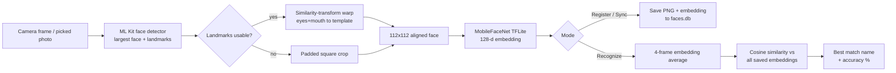

# Face Recognition — How It Works & Progress

As of 2026-11-06. Server sync, the API format and on-phone storage are documented in [FACE_SYNC_API.md](FACE_SYNC_API.md).

On-device face registration and live recognition built with Flutter, Google ML Kit face detection, and a MobileFaceNet TFLite embedding model. Recognition runs entirely on the phone; the only network use is the optional sync that pulls teachers' and students' photos from the school server.

## Pipeline overview

Both registration and live recognition share the same three-stage pipeline: **detect** a face, **align/crop** it to a canonical 112x112 image, then **embed** it into a 128-d vector compared by cosine similarity.

Registration and recognition use the *same* alignment code (`alignFace`) so the geometry embeddings are compared under matches exactly between the two paths.

## Registration flow

`RegisterFaceScreen` → `RegisterFaceNotifier` (`lib/features/register_face/register_face_notifier.dart`).

1. User types a name, then picks 3–5 photos from the camera or gallery. More angles/lighting per person directly raises match accuracy since the stored set is compared individually against each live embedding.
2. Each photo is decoded, then `img.bakeOrientation` bakes in EXIF rotation — ML Kit's file decoder honours EXIF but the raw pixel decoder doesn't, so without this step the detected box and the pixels disagree for portrait photos.
3. `enrollmentDetectorServiceProvider` runs ML Kit in **accurate** mode (slower, better landmarks — acceptable for a one-off photo) and picks the largest face.
4. `alignFace` warps the face to 112x112 using the eye/mouth landmarks (see Core algorithms below).
5. The aligned crop is embedded immediately via MobileFaceNet — embedding happens *before* the PNG is written, so a bad crop never gets a partial save.
6. Nothing touches disk until **Save**. Save writes each PNG + `FaceEntry` (name, image path, embedding, embedding version) to the repository, then **reads the index back from disk** and checks file existence/size to confirm the write actually landed before showing a success message.

Failures are per-photo (e.g. "no face detected" in one of five) rather than aborting the whole batch.

## Live recognition flow

`FaceRecognitionScreen` → `RecognitionNotifier` (`lib/features/face_recognition/recognition_notifier.dart`).

**Startup (`start()`)**
1. Loads all saved `FaceEntry` records; bails out with a message if none exist, or if the ones on disk predate the current embedding format (`embeddingVersion`) — forcing re-registration rather than silently comparing incompatible vectors.
2. Pre-loads the TFLite embedder so the first camera frame isn't spent waiting on model load.
3. Opens the front camera (`ResolutionPreset.medium`), with `bgra8888` on iOS and `nv21` on Android — the two formats the camera plugin returns as a single image plane. Orientation is locked to portrait for the session (rotation-aware detection is a known v1 limitation, see below).

**Per frame (`_onFrame`)**
1. Runs unthrottled — there's no timer; a new frame is simply dropped if the previous one is still processing, since the camera delivers frames faster than detection + embedding can run.
2. ML Kit (**fast** mode here, vs. accurate mode for registration) detects the largest face. No face → the panel shows "No face detected" after 3 consecutive misses (avoids flicker on a single dropped frame).
3. The raw frame is decoded and aligned/cropped to 112x112 **on a background isolate** (`cropFaceInBackground`) so per-pixel NV21→RGB conversion and the warp never block the UI thread.
4. The crop is embedded, then fed into a 4-frame `EmbeddingSmoother` that L2-normalises and averages recent embeddings — a single blurry or oddly lit frame can't swing the result. A new face that looks nothing like the running average (cosine < 0.4) resets the window instead of blending into it.
5. `bestMatch` compares the smoothed embedding against every saved entry by cosine similarity, scores each person by their best photo, and shows the name only when that person clears `matchThreshold` (0.85) **and** leads the next different person by `matchMargin` (0.05). Otherwise it shows "Unknown" (nobody close enough) or "Not sure" (two people too close to call).
6. Name + accuracy percentage render as plain text over the camera preview.

## Core algorithms

**Landmark alignment** (`face_alignment.dart`) — the biggest accuracy lever in the pipeline. Rather than a plain padded crop of the bounding box, the left/right eye and mouth-corner landmarks ML Kit reports are least-squares fit to a fixed template (the standard ArcFace/MobileFaceNet 112x112 reference points) via a similarity transform (rotation + uniform scale + shift). The face is then warped with bilinear interpolation so eyes and mouth always land in the same place regardless of head tilt or camera angle — this is what lets a straight-on registration photo match a slightly tilted live frame. Alignment is skipped (falling back to a padded square crop) when landmarks are missing, the eye distance is an implausible fraction of the box width, the tilt exceeds ~50°, or the mouth isn't below the eyes — i.e. whenever guessing would do more harm than a plain crop.

**Embedding** (`face_embedder_service.dart`) — the aligned 112x112 face is normalised (`(pixel - 127.5) / 128`) and run through **MobileFaceNet**, a TFLite model bundled in `assets/model/mobilefacenet.tflite`, producing a 128-d embedding vector. Faces of the same person land close together in this space; different people land far apart.

**Matching** (`face_similarity.dart`) — cosine similarity between the live embedding and every saved one, grouped by person id (so two people with the same name never merge). A name is only reported when the best person's score is ≥ `matchThreshold` (0.85) and at least `matchMargin` (0.05) ahead of the runner-up person; otherwise "Unknown" or "Not sure".

**Temporal smoothing** (`embedding_smoother.dart`) — live recognition averages the last 4 frames' L2-normalised embeddings before matching, so a single blurry frame or motion blur can't flip the result frame-to-frame. A big similarity drop between a new frame and the running average (a face swap in front of the camera) clears the window instead of blending old and new identities together.

**Embedding versioning** (`face_entry.dart`) — `embeddingVersion` is bumped whenever the crop/alignment method changes (currently 2, for landmark-aligned crops vs. v1's plain padded crop). Recognition refuses to compare against stale-version entries and prompts re-registration instead, so an accuracy regression from mixing embedding schemes can never happen silently.

## Data model and storage

Everything is stored locally under the app's documents directory (`getApplicationDocumentsDirectory()/assets/`) via `FaceRepository`, in a SQLite database `faces.db` (tables `people`, `face_photos`, `sync_state`) plus one 112x112 crop PNG per photo. Embeddings are stored as binary BLOBs, and each save or delete touches only its own rows. Faces saved by older versions in `faces_index.json` are imported automatically on first launch (the file is renamed to `faces_index.json.migrated`).

Full schema, file layout and sizes: [FACE_SYNC_API.md § 3](FACE_SYNC_API.md#3-what-the-phone-stores-and-where).

## Platform notes

Android and iOS hand the camera plugin different pixel formats, and the code path branches on `Platform.isIOS` in a few places rather than trying to normalise both into one format upfront:

| | Android | iOS |
| --- | --- | --- |
| Camera format | NV21 | BGRA8888 |
| Frame decode | Custom integer-math NV21→RGB conversion (`_nv21ToImage`) — replaced a per-pixel floating-point version that was the slowest step in the pipeline | Direct BGRA byte reinterpretation, no conversion needed |
| ML Kit rotation | google_mlkit_commons rotates the image and reports boxes in the *rotated* space — decoded pixels are rotated to match via `img.copyRotate` | google_mlkit_commons ignores rotation metadata — ML Kit's boxes stay in the raw buffer's space, so no rotation is applied |

Orientation is currently locked to portrait while the recognition screen is active (v1 limitation — full rotation support would combine `sensorOrientation` with live device orientation per lens direction).

**iOS build fix (2026-09-19):** `google_mlkit_commons` requires iOS 15.5+, but the Xcode project and Podfile were still targeting 13.0, which broke `pod install`. Fixed by setting `platform :ios, '15.5'` in `ios/Podfile` and `IPHONEOS_DEPLOYMENT_TARGET = 15.5` across all three build configurations in `ios/Runner.xcodeproj/project.pbxproj`, then running `pod install` clean (removed `Pods/`, `Podfile.lock`, `.symlinks/` first). Install completed successfully; the remaining CocoaPods warnings (`EXCLUDED_ARCHS` merge conflicts, base xcconfig notice) are common MLKit/TensorFlowLite pod noise and not build-blocking.

## Progress so far

Built test-first, feature by feature, over two days:

| Date | Milestone |
| --- | --- |
| Sep 18 | Dependencies added: camera, google_mlkit_face_detection, tflite_flutter |
| Sep 18 | Face data model + cosine similarity matching logic (TDD) |
| Sep 18 | Face crop geometry and overlay-scaling helpers (TDD) |
| Sep 18 | `FaceRepository` with JSON persistence (TDD) |
| Sep 18 | Device-dependent services wired up: detector, embedder, camera conversion, Riverpod providers |
| Sep 18 | Registration screen wired to real detection + embedding; EXIF-orientation and BGRA row-stride bugs fixed |
| Sep 18 | Live camera recognition shipped on `FaceRecognitionScreen`; Android box/crop coordinate mismatch fixed; retry button and lifecycle races hardened |
| Sep 19 | Screens moved to Riverpod `Notifier`s; recognition UI smoothed; stale counter-app test replaced with a real smoke test |
| Sep 19 | Result panel simplified to name + accuracy text; per-frame throttle removed in favour of a busy-flag drop |
| Sep 19 | **Landmark alignment** added (similarity-transform warp to the ArcFace template); multi-photo registration with an explicit Save step; 4-frame embedding averaging; faster NV21 decode via integer math |
| Sep 19 | iOS build fixed: deployment target raised to 15.5 for `google_mlkit_commons` compatibility, pods reinstalled |

Each step was landed with tests, then a follow-up "Fix" commit addressing review findings — the coordinate-space bugs (Android rotation, EXIF orientation, BGRA row stride) were the recurring class of issue, since detection boxes, decoded pixels, and crops all have to agree on the same coordinate space.

## Known limitations and next steps

- [ ] Portrait-only: the recognition screen locks orientation and assumes a fixed sensor angle; landscape/rotation support needs `sensorOrientation` combined with live device orientation per lens direction.
- [ ] No per-person management screen: synced people are added and removed by the server, but locally registered entries cannot be renamed or deleted from the UI.
- [ ] No liveness/anti-spoofing check — a photo of a photo can currently pass as a live face.
- [ ] Match threshold (0.85), margin (0.05) and smoothing window (4 frames) are fixed constants, not yet tuned against a labelled test set.
- [ ] iOS has not yet been run on a physical device or simulator since today's deployment-target fix — worth a build/run pass to confirm the pod changes resolve the original error end-to-end.
