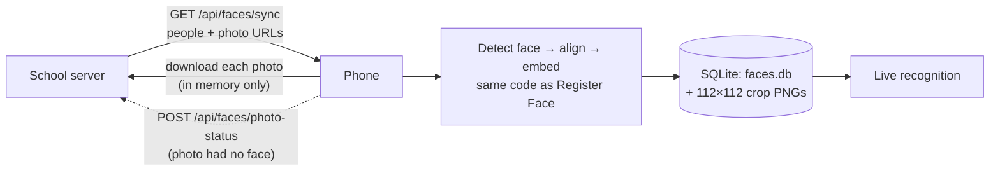

# Face Sync — Backend API and Phone Storage

As of 2026-11-06.

How the school's server sends teachers, students and their face photos to the app, how the phone stores them, and how recognition uses them. Hand sections 1–3 to the backend developer; the rest describes the app side.

Sized for: **100–200 teachers + ~400 students, 3 photos each → up to ~600 people / ~1,800 photos.**

---

## 1. The big picture



**The server sends photos, not embeddings.** An embedding is only comparable with another one made by the same model with the same face alignment, and that pipeline lives in the app. So every phone downloads the photos once and makes the embeddings itself. The server does not need any machine-learning code.

---

## 2. Backend API

The API is open: no login and no token. All responses are JSON in UTF-8. Plain `http://` is fine on the local network.

### 2.1 `GET /api/faces/sync`

| Query parameter | Required | Meaning |
|---|---|---|
| `since` | no | The `serverTime` from the last successful sync. **Omitted → send everyone** (first sync, or a full re-sync). Present → send only people created, changed or deleted after this time. |
| `cursor` | no | The `nextCursor` from the previous page. Omitted → first page. |

**Response `200`:**

```json
{
  "serverTime": "2026-11-06T10:00:00Z",
  "nextCursor": "eyJwYWdlIjoyfQ",
  "totalPeople": 612,
  "people": [
    {
      "id": "stu_1024",
      "type": "student",
      "name": "Aarav Patel",
      "classSection": "8-B",
      "rollNo": "23",
      "updatedAt": "2026-11-05T09:12:00Z",
      "deleted": false,
      "photos": [
        {
          "id": "ph_5531",
          "url": "https://cdn.school.example/faces/ph_5531.jpg",
          "sha256": "9f2c4e…",
          "updatedAt": "2026-11-05T09:12:00Z"
        },
        { "id": "ph_5532", "url": "https://cdn.school.example/faces/ph_5532.jpg", "sha256": "1ab0…" },
        { "id": "ph_5533", "url": "https://cdn.school.example/faces/ph_5533.jpg", "sha256": "77de…" }
      ]
    },
    {
      "id": "stu_0877",
      "deleted": true
    }
  ]
}
```

**Fields**

| Field | Type | Required | Notes |
|---|---|---|---|
| `serverTime` | string | **yes** | The server's clock when *this sync* started. Send the same value on every page of one sync. The phone sends it back as `since` next time. |
| `nextCursor` | string \| null | yes | `null` on the last page. |
| `totalPeople` | int | no | Total people across all pages of this sync. Only used for the progress bar. |
| `people[].id` | string | **yes** | Stable and unique forever, e.g. `stu_1024`, `tch_17`. **Never reuse an id**, and never change it. The phone matches people by this id, which is why two students both named "Aarav Patel" stay separate. |
| `people[].type` | string | yes | `teacher` or `student`. |
| `people[].name` | string | yes | Shown on screen when recognised. |
| `people[].classSection` | string | no | e.g. `8-B`. |
| `people[].rollNo` | string | no | |
| `people[].updatedAt` | string | no | ISO-8601. |
| `people[].deleted` | bool | no | `true` → the phone deletes this person and all their photos. Only `id` is needed alongside it. |
| `people[].photos` | array | yes (unless deleted) | **The complete current list of this person's photos**, not just the new ones. Any photo the phone has that is missing from this list is deleted from the phone. |
| `photos[].id` | string | **yes** | Stable and unique. |
| `photos[].url` | string | **yes** | Where to download the image. Can be a CDN or a signed URL. |
| `photos[].sha256` | string | strongly recommended | Hex SHA-256 of the image file. If it is unchanged the phone skips the download. Without it, the photo is downloaded on every sync. |
| `photos[].updatedAt` | string | no | |

### 2.2 Rules the server must follow

1. **When anything about a person changes** (name, class, a photo added, replaced or removed), bump that person's `updatedAt` so they appear in the next `since` sync, and send their **full** photo list.
2. **Never just stop sending a removed person.** Send them once with `"deleted": true`. Otherwise phones never find out they left. Keep deleted records (soft delete) long enough for every phone to sync. Several months is safe.
3. **Replace a photo by giving it a new `sha256`** (same id) **or a new id**. Both work.
4. **Page size about 100 people.** Order pages stably (e.g. by `id`) so a cursor never skips or repeats people.
5. **`since` filter:** return people where `updatedAt > since` (including deletions). Compare with the server's own clock, never the phone's.
6. **Errors:** any non-`200` status (e.g. `5xx` for server trouble). The phone shows the message and keeps its existing data. The next sync simply retries.

### 2.3 Photo requirements

| | |
|---|---|
| Format | JPEG (PNG also works) |
| Size | ~640 px on the longest side, quality ~80 → **60–120 KB each**. Larger photos are shrunk on the phone anyway (to 1,280 px max), so anything bigger only wastes data. |
| Content | **One** face, looking at the camera, eyes open, no sunglasses or mask, face filling at least a third of the frame |
| Lighting | Even and bright, no strong shadow across half the face |
| The 3 photos | Make them different: **straight on, turned slightly left, turned slightly right.** Three near-identical photos add little. |

A first sync of 1,800 photos downloads about **150 MB** once. Later syncs only download changes.

### 2.4 `POST /api/faces/photo-status` (optional)

The phone calls this when a photo cannot be used, so the office can upload a better one. The phone ignores the response and any failure, so this endpoint is optional.

```json
{ "photoId": "ph_5532", "status": "rejected", "reason": "No face detected in the image." }
```

Reply `200` (any body).

### 2.5 Example: how syncs look over time

| When | Phone sends | Server returns |
|---|---|---|
| First launch | `GET /api/faces/sync` | All ~600 people over ~6 pages; `serverTime: "T1"` on each |
| Next day | `GET /api/faces/sync?since=T1` | Only the 3 students who changed, plus 1 with `deleted: true`; `serverTime: "T2"` |
| Nothing changed | `GET /api/faces/sync?since=T2` | `{"serverTime": "T3", "nextCursor": null, "people": []}` |

---

## 3. What the phone stores, and where

Everything lives in the app's private documents folder: `<app documents>/assets/`. Other apps cannot read it. It is removed when the app is uninstalled.

```
assets/
├── faces.db                   SQLite database (people, photos, embeddings)
├── face_<time>_<n>.png        112×112 crops from the Register Face screen
├── faces_index.json.migrated  old JSON store, imported once (safe to delete later)
└── synced/
    └── <photoId>.png          112×112 crops of photos from the server
```

**The downloaded original photo is never saved.** Only the small 112×112 aligned face crop (for display) and the embedding are kept (see section 6).

### 3.1 Database schema (`faces.db`)

```sql
CREATE TABLE people (
  id            TEXT PRIMARY KEY,   -- server id ("stu_1024"), or "local:<name>" for Register Face
  type          TEXT NOT NULL,      -- teacher | student | local
  name          TEXT NOT NULL,
  class_section TEXT,
  roll_no       TEXT,
  updated_at    TEXT
);

CREATE TABLE face_photos (
  id                TEXT PRIMARY KEY,  -- server photo id, or "local_<time>_<n>"
  person_id         TEXT NOT NULL REFERENCES people(id) ON DELETE CASCADE,
  sha256            TEXT,              -- to skip unchanged photos
  crop_path         TEXT NOT NULL,     -- the 112×112 PNG
  embedding         BLOB NOT NULL,     -- 128 float64 values = 1,024 bytes
  embedding_version INTEGER NOT NULL,  -- see 4.3
  updated_at        TEXT
);
CREATE INDEX face_photos_person ON face_photos(person_id);

CREATE TABLE sync_state (key TEXT PRIMARY KEY, value TEXT);  -- "last_sync" → serverTime
```

### 3.2 Size and speed for the school

| | ~1,800 photos / ~600 people |
|---|---|
| Crop PNGs | ~35–55 MB |
| `faces.db` | ~2–3 MB |
| **Total on the phone** | **~40–60 MB** |
| Opening the recognition screen | well under a second |
| Matching one camera frame against everyone | ~1–2 ms |

These are estimates; detection and the face model take the same time no matter how many people are stored.

---

## 4. How a sync works (app side)

Home → **Sync Faces from Server** → **Sync now**.

1. If any synced photo was made with an older `embedding_version`, request everyone (no `since`). Otherwise send `since = last_sync`.
2. Fetch pages until `nextCursor` is `null`. For each person:
   - `deleted: true` → delete the person, their photo rows and their crop files.
   - Otherwise save or update the person. For each photo:
     - **Same `sha256`, current embedding version, crop file present → skip** (no download).
     - Otherwise **download into memory → detect → align → embed → save the crop + embedding**.
     - No face found → listed on the sync screen and reported via `photo-status`. **The sync continues.**
     - A broken photo URL → listed on the sync screen. **The sync continues.**
   - Photos the phone has that are no longer in the person's list → deleted.
3. Only when **every page succeeded** is `last_sync` saved, using the first page's `serverTime`. If the sync fails halfway (no network, server error), nothing is lost. The next sync repeats the same request, and already-stored photos are skipped by `sha256`.

### 4.1 First-sync time

Each new photo takes roughly a download plus 0.2–0.5 s of on-device processing. For 1,800 photos, expect **about 10–15 minutes** on a mid-range phone. Keep the app open on the sync screen; the back button is disabled while syncing. Later syncs take seconds.

### 4.2 Register Face screen still works

Faces added on the phone through **Register Face** are stored in the same database as `type = local` with id `local:<name>`. Registering the same name again adds photos to the same person, as before. A sync never touches local people.

### 4.3 Embedding versions

`currentEmbeddingVersion` in `lib/services/face/face_entry.dart` is bumped whenever the face model or alignment changes. On the next sync the phone notices synced photos with the old version and re-downloads everyone automatically; **the backend does not need to change anything.** Locally registered faces with an old version must be registered again (the recognition screen says so).

---

## 5. How recognition decides

`lib/services/face/face_similarity.dart`:

1. Each stored photo is compared with the live face (cosine similarity).
2. **Each person's score = their best photo.** A person's own photos never compete with each other.
3. The best person is accepted only if **both** of these hold:
   - score ≥ `matchThreshold` (**0.85**)
   - score is at least `matchMargin` (**0.05**) ahead of the **next different person**
4. The screen shows:
   - the person's **name** (green) when both conditions hold
   - **Not sure** (orange) when two people both score high but too close together, e.g. look-alike siblings
   - **Unknown** (orange) when nobody reaches the threshold

**Tune these after a real trial.** Register 20–30 people, walk each past the phone, and note scores:
- the right person often shows "Unknown" at 80–84% → lower `matchThreshold` slightly (e.g. 0.80)
- wrong names appear → raise `matchThreshold`
- too many "Not sure" → lower `matchMargin` (e.g. 0.03)

---

## 6. "How does the phone delete downloaded photos?"

### What `Image.network` does

`Image.network(url)` downloads the image and keeps the decoded picture in Flutter's **in-memory** image cache (`PaintingBinding.instance.imageCache`, ~100 MB by default). It does **not** save a file to the phone's storage. The cache is RAM, so it is cleared when the app is closed or when the cache gets full. That is why you never had to delete anything: nothing was ever written to disk.

(The `cached_network_image` package is different: it **does** save files to a disk cache folder. This project does not use it.)

### What this app's sync does

The sync never uses `Image.network` and never writes the original photo to storage:

```dart
// lib/services/face/api/face_remote_repository.dart
// The photo is downloaded straight into a Uint8List (RAM). No file is created.
Future<Uint8List> downloadPhoto(String url) async {
  final response = await _send(() => _client.get(uri, headers: ...));
  return response.bodyBytes;
}
```

```dart
// lib/services/face/face_sync_service.dart
final bytes = await remote.downloadPhoto(photo.url);  // original, in RAM only
final enrolled = await enrollPhoto(bytes);            // → 112×112 crop + embedding
await crop.writeAsBytes(enrolled.png, flush: true);   // only the small crop is saved
// `bytes` is just a variable. When the function returns, Dart's garbage
// collector frees that memory automatically; there is nothing to delete.
```

One short-lived file does exist: ML Kit's face detector on iOS needs a file path, so an upright JPEG is written to the OS temp folder and **deleted straight after detection**, even if detection fails:

```dart
// lib/services/face/face_enrollment.dart
await tempFile.writeAsBytes(jpg, flush: true);
try {
  face = await detector.detectLargestFace(InputImage.fromFilePath(tempFile.path));
} finally {
  if (await tempFile.exists()) await tempFile.delete();   // always runs
}
```

### How a file *is* deleted in Flutter

When something does need removing, the code uses `dart:io`'s `File.delete()`, e.g. when a student is removed on the server:

```dart
// lib/services/face/face_repository.dart
Future<void> deletePerson(String personId) async {
  final photos = await photosOf(personId);
  await db.delete('people', where: 'id = ?', whereArgs: [personId]); // rows (photos cascade)
  for (final photo in photos.values) {
    final file = File(photo.cropPath);
    if (await file.exists()) await file.delete();                   // crop files
  }
}
```

To show a stored crop on screen, use `Image.file(File(entry.imagePath))`. It reads the existing file and does not download or copy anything.

---

## 7. Running the app against your local server

The API is open, so the only setting is the server address, passed at build time:

```bash
flutter run --dart-define=FACE_API_BASE_URL=http://192.168.1.20:8000
```

Without `FACE_API_BASE_URL`, the sync screen says no server is set.

### Which address to use

`localhost` always means *the device the app runs on*. On a phone, `http://localhost:8000` points at the phone itself, not your computer.

| App runs on | Use |
|---|---|
| **Real phone (Android or iPhone)** | Your computer's **LAN IP**, e.g. `http://192.168.1.20:8000`. Phone and computer must be on the **same Wi-Fi**. |
| Android emulator | `http://10.0.2.2:8000` (the emulator's alias for your computer) |
| iOS simulator | `http://localhost:8000` works (the simulator shares the Mac's network) |

Find your Mac's IP with `ipconfig getifaddr en0`. The server must listen on all interfaces, not just `127.0.0.1`, for example:
- Django: `python manage.py runserver 0.0.0.0:8000`
- Node/Express: `app.listen(8000, '0.0.0.0')`
- Laravel: `php artisan serve --host 0.0.0.0 --port 8000`

Photo `url`s in the API response must use that same reachable address (e.g. `http://192.168.1.20:8000/media/ph_5531.jpg`), **not** `http://localhost/...`, or the phone cannot download them.

### Plain HTTP permissions (already set up)

- **Android:** plain `http://` is allowed in **debug** builds via `android:usesCleartextTraffic="true"` in `android/app/src/debug/AndroidManifest.xml`. Release builds still require HTTPS. Move to HTTPS before going live, or add the flag to `android/app/src/main/AndroidManifest.xml` if the release app must also use plain HTTP on the school network.
- **iOS:** `Info.plist` has `NSAllowsLocalNetworking` (plain HTTP to local addresses) and `NSLocalNetworkUsageDescription`. The first sync shows an **"allow local network access"** prompt. Tap **Allow**, or the sync cannot reach your computer. If you tapped Don't Allow, turn it on under Settings → Privacy & Security → Local Network.

## 8. Code map

| File | Role |
|---|---|
| `lib/services/face/api/face_api_config.dart` | Server URL |
| `lib/services/face/api/face_api_models.dart` | JSON models: `SyncPage`, `RemotePerson`, `RemotePhoto` |
| `lib/services/face/api/face_remote_repository.dart` | **Fetches faces from the API**: sync pages, photo downloads, photo-status reports |
| `lib/services/face/face_sync_service.dart` | Runs a sync: compares server data with the phone, downloads, enrolls, deletes |
| `lib/services/face/face_enrollment.dart` | Photo → aligned 112×112 crop + embedding. Shared by sync and Register Face. |
| `lib/services/face/face_repository.dart` | SQLite storage (`faces.db`), JSON migration, deletes |
| `lib/services/face/face_entry.dart` | `FaceEntry` (one stored photo), `currentEmbeddingVersion` |
| `lib/services/face/face_similarity.dart` | Matching: per-person best score, threshold, clear-winner margin |
| `lib/features/face_sync/` | Sync screen + notifier |
| `lib/features/register_face/` | Register Face screen (unchanged for the user) |
| `test/services/face/face_sync_service_test.dart` | Sync rules against a fake server |

## 9. Not done yet

- [ ] Background or automatic sync. Today it only runs when someone presses **Sync now** with the app open.
- [ ] A screen listing stored people with delete or rename.
- [ ] Liveness check. A printed photo can still pass as a face.
- [ ] Threshold and margin tuned on a real trial (section 5).
